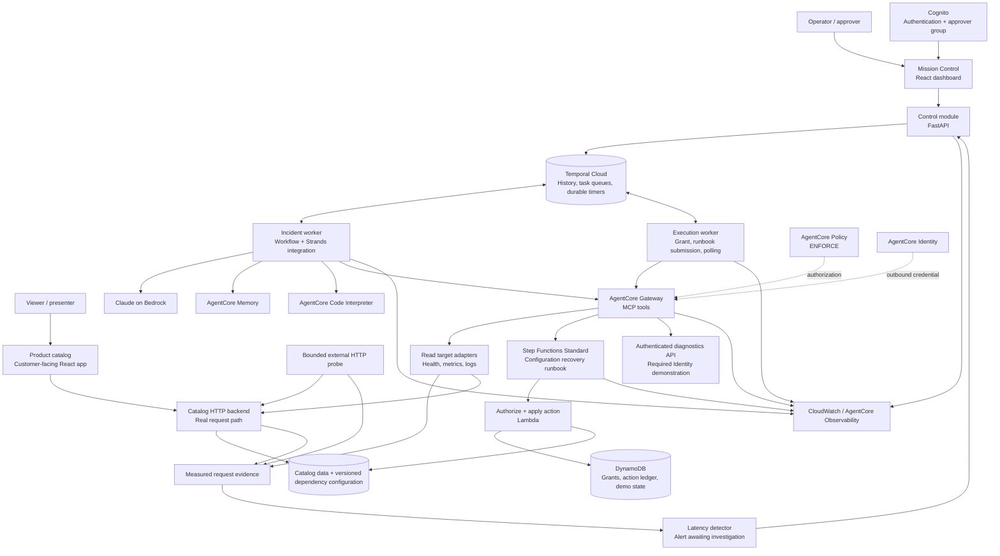

# High-level design: the on-call agent that survives its own outage

## 1. Purpose and scope

Build a 10-minute core demonstration, expandable to 20 minutes, of a real application becoming slow and recovering through durable incident response. The first release uses Temporal Cloud and a dedicated product-catalog application with an intentionally injected backend/dependency latency fault. The fault is controlled, but HTTP response times and the browser experience are real measurements. Label the environment as a fault-injection demo; do not label measured requests as fabricated telemetry.

The user requires every named feature in the pitch. Delivery is staged: a working local-worker slice first, then complete AgentCore integrations and the hosted-worker/operational-controls stage. Conditional access can delay a stage but must not silently remove it from scope.

The agent proposes actions. Deterministic workflow logic and an independently enforced runbook decide whether an action may execute. AgentCore Memory informs diagnosis but is not the record of workflow progress or authorization.

### Success criteria

1. Duplicate delivery of the same alert does not start a second incident workflow.
2. After a worker crash, recorded health and metrics results are reused, and workflow execution continues.
3. A flaky metrics tool succeeds after two injected 503 responses, with observable attempt counts and bounded retries.
4. No remediation occurs before an authorized approval of the current proposal.
5. A 90-second durable timer schedules escalation; a worker executes the notification when available.
6. Repeated approval, Activity retry, or a lost submission response cannot apply the same configuration recovery twice.
7. Step Functions completion and independent health verification are both visible before the incident is marked resolved.
8. Temporal history and CloudWatch traces can be correlated using incident and workflow identifiers.
9. Viewers can open the catalog, search, and feel the slow response before seeing Mission Control; no artificial browser spinner creates the delay.
10. The dashboard alert is derived from actual request measurements, and the presenter explicitly starts investigation after showing it.
11. The approved runbook restores a known-good configuration used by the request-serving backend. The same route/query becomes faster, with correct results and independent before/after evidence.

These are acceptance targets. They are not claims that the implementation already exists.

### Out of scope for the baseline

Real database restart; autonomous production changes; fleet-wide remediation; unrestricted shell commands; unapproved rollback or chained secondary remediation; multi-region failover; real external paging. The approved known-good configuration restore is in scope. The first working slice does not rely on pre-release hosting; full completion does require it.

## 2. Architecture



The boxes represent logical responsibilities, not a requirement to deploy one server per box. The initial incident and execution workers are separate local processes using separate least-privilege roles, both connected to Temporal Cloud. The recovery changes the versioned dependency configuration in DynamoDB that the catalog HTTP backend reads on every request. This is an actual configuration rollback for an injected fault, not a real database restart or a dashboard-only reset.

### The user-visible application

Use a small storefront named **DemoShop**, with a product list, keyword search, and a product-detail view. The frontend makes real HTTP calls to an isolated API Gateway/Lambda backend using a seeded DynamoDB catalog. Hosting can begin locally for the frontend while the request-serving backend is in AWS; the same application URL and backend are used before and after remediation.

A privileged fault control enables a fixed four-second delay in the catalog's dependency adapter. The delay happens on the server, within the measured request span, before returning actual catalog data. This emulates a slow dependency without claiming an organically failing production database. The approved `restore_service_config` action restores the verified prior configuration with no injected delay. Neither a restart of the browser nor a dashboard toggle can perform that recovery.

An independent low-rate probe issues the same public catalog request. The detector opens an alert from those measurements; presentation mode waits for **Investigate with SRE** rather than starting the agent automatically. Real user traffic is optional and is not required to sustain the alert. See [DEMO_PLAN.md](DEMO_PLAN.md) for the walkthrough and acceptance measurements.

AgentCore Gateway exposes read tools and a runbook integration. The Strands model receives only the read-tool definitions. This tool allowlist reduces accidental exposure; it is not sufficient authorization by itself. The runbook checks a persisted grant even if someone reaches its execution tool outside the intended agent path.

## 3. Main modules

| Module | Small interface | Responsibility it owns |
|---|---|---|
| Incident control | Inspect alert, start investigation, inspect incident, decide proposal | Measured-alert ingestion, manual/automatic trigger mode, authenticated operator identity, deduplication, typed workflow calls |
| Durable incident | Start workflow; accept decision Update; expose state Query | Incident state machine, deadlines, escalation, Activity scheduling, cancellation, recovery |
| Diagnosis | Diagnose incident with bounded evidence | Strands/Bedrock reasoning, durable read tools, memory recall, anomaly analysis with graceful failure, structured proposal validation |
| Approval and execution | Authorize proposal; submit and reconcile action | Immutable grants, target/action allowlists, idempotency, runbook orchestration, uncertainty handling |
| Demo application | Search catalog, view product, read measured evidence | Real customer-facing HTTP requests, immutable request timing, trace correlation, unchanged data before/after recovery |
| Demo environment | Inject fault; restore known-good configuration | Controlled server-side delay, versioned configuration, atomic recovery of the expected incident generation; no health-score fabrication |
| Evidence and audit | Store bounded evidence; correlate execution | Redaction, evidence references, structured audit events, traces and model-usage measurements |

Interfaces hide SDK details. Only introduce interchangeable adapters where the behavior actually varies: simulated versus AWS-connected evidence, or local-worker versus Runtime deployment configuration. Do not introduce a general multi-cloud abstraction for this demo.

## 4. End-to-end flow

```mermaid
sequenceDiagram
    actor Human as Approver
    participant UI as Mission Control
    participant T as Temporal Cloud
    participant W as Incident worker
    participant A as AWS evidence / Bedrock
    participant E as Execution worker
    participant G as Gateway / Step Functions
    participant D as Grant ledger / demo service

    Note over UI,A: Presenter first experiences slow app; measured alert is visible
    UI->>T: Presenter clicks Investigate with SRE through control module
    T->>W: Schedule workflow tasks and Activities
    W->>A: Gather evidence and diagnose through durable Activities
    A-->>W: Evidence and structured proposal
    W->>T: Persist proposal and wait condition + durable timer
    Note over T,W: Worker may stop; history and timer remain durable
    T->>W: Escalation becomes due
    W->>T: Record escalation Activity result when a worker is available
    Human->>UI: Approve exact proposal
    UI->>T: Validated decision Update
    T-->>UI: Decision accepted or rejected
    T->>E: Create bound grant, recheck target, submit action
    E->>D: Conditional grant and action ledger writes
    E->>G: Start Standard execution with deterministic action ID
    G->>D: Validate grant, restore request-serving configuration atomically
    E->>G: DescribeExecution until terminal
    G-->>E: Terminal result
    T->>W: Independently verify health
    W->>A: Fresh requests to actual catalog route; latency and correctness
    W->>T: Resolved or unresolved result
    Note over UI,A: Presenter repeats same search in actual app to feel recovery
```

The UI talks to the control module; its direct arrow toward Temporal in this sequence is shorthand for that authenticated path. Browsers receive neither Temporal credentials nor AWS execution credentials.

## 5. Durability model

**Temporal Cloud owns durable execution state.** It stores the workflow history, decision Update outcome, timers, Activity outcomes, and workflow status. Worker memory is disposable. Workflow code must remain deterministic and perform no direct network, filesystem, clock, or random calls outside supported SDK facilities.

**Activities perform external work.** Completed results already recorded by Temporal are replayed without repeating the call. A call whose completion was not recorded can run again. The same ambiguity exists when an external side effect succeeds but the Activity worker dies before acknowledging completion.

**External effects own deduplication.** Stable action IDs, immutable proposal hashes, deterministic Step Functions execution names, and conditional DynamoDB writes handle repeated delivery. Temporal alone does not provide exactly-once external execution.

**Waiting is durable scheduling.** Approval waiting uses a workflow condition and timer, never a long-running polling Activity or an open LLM conversation. A worker process need not stay alive solely for that wait. Temporal Cloud and other resources can still cost money. A timer can become due while every worker is stopped, but an escalation Activity cannot execute until a capable worker is running.

## 6. Storage and ownership

| Record | Source of truth | Notes |
|---|---|---|
| Incident phase, current proposal, human decision, deadlines | Temporal workflow | Query for the small demo UI; a production read model can be added later |
| Approval grant and action execution ledger | DynamoDB | Server-only writes, conditional transitions, strongly consistent reads where required |
| Fault generation, configuration versions, recovery count | DynamoDB | Actual request-serving configuration; separate from grants; no stored flag overrides measured health |
| Alert, bounded recent request samples, probe evidence | DynamoDB | Separate alert lifecycle; append measured observations; retain baseline and post-action windows |
| Catalog content | DynamoDB | Seeded products; product data remains unchanged by latency remediation |
| Large evidence payloads | Encrypted S3 | Store redacted bounded records and return references; account for observability copies |
| Past incident knowledge | AgentCore Memory | Advisory, environment-scoped, bounded, never authorization |
| Diagnostic traces and audit copies | CloudWatch | Not used as the authoritative state machine |

Temporal history contains only small structured results and evidence references. Proposed maximum serialized Activity result is 32 KiB; larger redacted evidence goes to S3. Retention values are deployment configuration and must be applied to every copy, including Temporal Cloud history and tracing.

## 7. Trust and authorization

- Cognito authenticates operators. The control module verifies issuer, audience/token-use requirements, signature, expiry, and approver group. Client-supplied actor names or roles are ignored.
- Only the control module's Temporal client identity may submit human decisions. Namespace access must be tightly controlled; a direct Temporal client that can manipulate the workflow is a privileged administrative trust path.
- Diagnosis has no permission to write approval grants or modify the demo state. The execution worker can persist a grant only through the approved deterministic workflow path; compromising that worker is a privileged breach.
- The runbook performs an independent grant check before recovery. A grant binds incident, proposal hash/version, target, action, incident generation, active configuration version, known-good configuration digest, server-side approver, and expiry.
- The Gateway service role can start and inspect only the allowlisted state machine, subject to the connector's documented permission model. The state machine role can invoke only its designated Lambda functions.
- Target functions reject unknown targets and actions. No model-generated ARN, URL, command, IAM role, or state-machine definition is executed.
- AgentCore Policy must be enabled in enforcement mode in the full feature stage, with positive and negative authorization tests. Its exact supported principal/tool/input rules must be validated against the deployed schemas. It does not replace the target-side grant check or assume access to nested fields inside serialized Step Functions input.
- AWS service integrations use IAM. AgentCore Identity is exercised by a required authenticated HTTPS diagnostics target behind Gateway: its scoped API-key credential is retrieved from the Identity credential provider and applied outbound. The target independently validates the credential. It provides synthetic vendor-style diagnostic context and has no remediation authority.
- Logs, retrieved memories, and model output are untrusted evidence. They cannot manufacture approvals, extend deadlines, or select arbitrary runbooks.

## 8. Deployment topology

### Baseline demo

| Location | Runs there |
|---|---|
| Operator machine | DemoShop frontend, Mission Control, FastAPI, bounded HTTP probe, incident worker, execution worker; separate processes |
| Temporal Cloud | Namespace, task queues, history, timers, Temporal Web UI |
| AWS, proposed `us-east-1` | Bedrock; AgentCore Gateway, Identity, Memory, Code Interpreter, Policy; Lambda; Step Functions Standard; DynamoDB; S3; Cognito; CloudWatch; authenticated diagnostics HTTPS endpoint and secret storage |

Use short-lived or appropriately secured role credentials and a supported Temporal Cloud authentication method. Inject secrets through local secure configuration or a secret manager; never commit them. Readiness checks determine the exact model and deployment versions.

For the crash demonstration, kill the incident worker PID, not the Temporal service or the control interface. The execution worker remains separate so the demo can show execution continuing independently after an action has been submitted. A separate scenario may stop both workers to demonstrate that external Step Functions execution continues but workflow reconciliation waits for worker recovery.

### Required later hosted deployment

Add an AgentCore Runtime deployment using Temporal Serverless Workers after access and compatibility are proven. Runtime is an alternative worker deployment, not a second workflow engine. Use Worker Versioning and a named Runtime endpoint pinned to the matching worker version; do not route durable runs through an unversioned mutable endpoint. Verify session behavior, dispatch, reconnection, secrets, worker versioning, and observability before declaring this feature complete. If pre-release access is unavailable, the earlier stages remain usable but full feature completion is blocked.

The UI/control module may remain local for the teaching demo; hosting it is not required to demonstrate Runtime workers. Run a separate hosted-deployment scenario with explicit task-queue/version routing so local and hosted workers cannot accidentally compete for the crash demo's work.

Production readiness additionally requires scoped Temporal roles, highly available workers, tested workflow upgrades, incident ingestion authentication, retention policies, capacity planning, real provider idempotency, and operational ownership. The current design deliberately does not claim production readiness.

## 9. Reliability and budgets

| Failure | Designed response |
|---|---|
| Incident worker crash | Another compatible worker replays and resumes; unrecorded Activity work may repeat |
| Bedrock throttle or timeout | Bounded retries and spend/iteration caps; manual investigation after exhaustion |
| Read-tool 503 | Exponential backoff with visible attempt counters |
| Missing approval | One escalation at 90 seconds; expire the proposal at 10 minutes |
| Invalid or stale approval | Reject with a typed reason; never infer consent |
| Lost runbook submission response | Reconcile deterministic execution identity and ledger before resubmission |
| Target generation changed | Reject the stale action and require a new incident/proposal |
| Runbook succeeded but application still slow or incorrect | Mark unresolved; no unapproved second action |
| Memory or trace system unavailable | Degrade diagnostic enrichment or visibility; preserve core workflow and audit state |

An initial run allows at most 6 model turns, 12 read-tool calls, one actionable proposal, and one approved action. Attempt/time/token limits are configurable and checked before further calls. These controls bound activity; they are not a hard AWS billing limit. Cost review must include model tokens, Temporal Cloud, Code Interpreter sessions, Step Functions transitions, Lambda, DynamoDB, S3, tracing, and any hosted worker idle time.

The app adds real backend invocations, billed duration during injected delays, and low-rate probe traffic. Use one probe request every five seconds with concurrency one and a 15-minute automatic stop. Re-estimate from a rehearsal before treating the earlier $1-per-demo budget as measured; an indefinitely running traffic generator is not included in that estimate.

## 10. Implementation sequence and release gates

1. **Connectivity:** Temporal Cloud namespace and auth; current AWS SDK; exact Bedrock model access; service availability and quotas. Prove a single read Activity.
2. **Application and detection:** working DemoShop/catalog HTTP path, controlled backend latency, real timing/logging, bounded probes, measured alert awaiting manual investigation. Prove visible slowness before building recovery.
3. **Durable triage:** Strands integration with per-call Activities, validated proposal, replay fixture, kill/restart demonstration.
4. **Human control:** authenticated UI, decision Update, durable escalation/expiry, refusal and cancellation paths.
5. **Safe recovery:** grant ledger, version-bound known-good configuration restore via Gateway/Standard runbook, idempotency, reconciliation, actual-route latency/correctness verification, and browser before/after test.
6. **Full AgentCore integration:** Memory, Code Interpreter, correlated traces, Identity-backed authenticated diagnostics, and Gateway Policy enforcement. Prove each with positive/negative tests.
7. **Hosted and operational controls:** obtain pre-release access, validate Runtime/serverless worker deployment, and demonstrate live Activity-option changes. These are required full-coverage gates.
8. **Rehearsal:** repeated acceptance scenarios across local and hosted deployment profiles, current cost review, trace preflight, and cleanup proof.

## 11. Architectural decisions

| Decision | Reason | Tradeoff |
|---|---|---|
| Temporal Cloud from day one | User choice; durable control plane independent of worker laptop | Requires external account/namespace and ongoing service cost |
| Local workers for initial live demo | Visible and repeatable process crash | Not highly available; callbacks wait for worker recovery |
| Deterministic approval workflow around a bounded agent | Makes risky transitions auditable and testable | More explicit workflow code than an unconstrained agent |
| Standard Step Functions | Asynchronous runbook and named-execution reconciliation | Requires polling and duplicate/terminal-execution handling |
| Target-side approval validation | Protects remediation even when a Gateway tool is called directly | Adds grant and ledger state |
| Real catalog app with injected dependency latency | Viewers feel the problem and recovery on the same application | Proves the request path and configuration recovery, not real database repair |
| Measured alert then manual investigation | Matches the presenter's app → dashboard → agent narrative | Automatic investigation is a separate explicitly selected mode |
| One current proposal and one action per incident | Keeps approvals and execution semantics clear | Further remediation starts a new proposal flow/incident version |
| AgentCore Runtime staged but required | Enables early progress while pre-release access is obtained | Full coverage remains incomplete until the hosted path is exercised |

See [RESEARCH.md](RESEARCH.md) for source-backed integration constraints, [LLD.md](LLD.md) for implementation contracts, and [DEMO_PLAN.md](DEMO_PLAN.md) for the application story and build plan.
