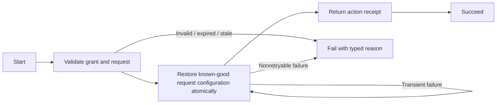

# Low-level design: durable SRE incident workflow

Status: proposed contracts and algorithms, not implemented code. Read [HLD.md](HLD.md) for scope and [RESEARCH.md](RESEARCH.md) for the source-backed vendor constraints.

## 1. Technology and package layout

Use Python for FastAPI, workflow/Activities, and Lambda handlers; React/TypeScript for Mission Control. Pin and test the Python version and all dependencies together. The documented Strands integration currently uses `temporalio-strands-agents`, `temporalio.strands_agents`, and workflow helpers in `temporalio.strands_agents.workflow`; it is Public Preview. Do not assume older sample imports still work.

Proposed repository layout:

```text
apps/
  mission_control/              # React frontend
  demo_shop/                    # Customer catalog/search frontend
src/sre_agent/
  control/                     # Auth, HTTP contracts, Temporal client
  domain/                      # Typed contracts, proposal validation, errors
  workflows/incident.py        # Deterministic state machine
  diagnosis/                   # TemporalAgent setup, bounded read tools
  activities/                  # Evidence, model integration, grants, runbooks
  adapters/                    # Gateway, Bedrock, Memory, S3, DynamoDB
  workers/incident.py          # Incident workflow + diagnosis registrations
  workers/execution.py         # Privileged grant/runbook registrations
  observability/               # Redaction, correlation, structured events
  detection/                   # Bounded HTTP probes, measured alert lifecycle
lambda/
  demo_read/                   # Measured health/metrics/logs; separate test fixtures
  catalog/                     # Real catalog HTTP path + dependency fault adapter
  inject_fault/                # Isolated demo control
  authorize_recovery/          # Validate immutable approval/action binding
  apply_recovery/              # Atomic request-config restore + receipt
  diagnostics_authorizer/     # Authenticate Identity-injected API key
  diagnostics_context/        # Scoped synthetic diagnostics HTTPS tool
infra/                         # One infrastructure-as-code stack, isolated env
tests/
  workflow/                    # Time-skipping and replay tests
  contracts/                   # MCP schemas, model output, runbook payloads
  integration/                 # Cloud path and failure injection
scripts/                       # Preflight, seed, rehearse, cleanup
docs/design/
```

Task queues: `sre-incident-v1` for the workflow, model/read Activities, enrichment, and escalation; `sre-execution-v1` for grant creation, submission, and status reconciliation. Registration must match queue routing. Use separate process credentials so the incident worker cannot write approval grants or mutate demo state. Both queues need monitoring for absent workers and backlog. The hosted deployment uses explicit version routing and distinct demo configuration; do not let an unplanned hosted worker consume the local crash scenario's tasks.

## 2. Domain records

All public records carry `schema_version`. Validate with strict schemas; reject unknown action fields and oversized values. Timestamps use UTC RFC 3339; display in the user's chosen timezone. IDs are opaque strings without account credentials.

| Record | Required fields and rules |
|---|---|
| `AlertRecord` | `alert_id`, target/route/query digest, fault generation, triggering sample IDs, threshold/window, `status=OPEN\|INVESTIGATING\|RECOVERED`, timestamps, optional workflow ID; alert detection does not itself imply agent execution |
| `IncidentInput` | `incident_id`, `alert_id`, `source`, `source_event_id`, `environment`, `target_id`, `fault_generation`, `observed_at`, `summary`, `severity`, `schema_version`; target comes from an allowlist |
| `EvidenceRef` | `evidence_id`, `kind`, `uri`, `sha256`, `captured_at`, `data_origin=measured\|fixture`, `fault_injected`, `summary`; URI is generated by an adapter, never accepted as an arbitrary model URL |
| `DiagnosisResult` | `hypothesis`, `evidence_ids`, `confidence_note`, optional `proposal`, `usage_summary`; evidence IDs must belong to this incident |
| `Proposal` | `proposal_id`, `version`, `incident_id`, `action=restore_service_config`, `target_id`, `expected_generation`, `expected_config_version`, `restore_config_digest`, `reason`, `evidence_ids`, `risk`, `created_at`, `expires_at`, `proposal_hash` |
| `DecisionCommand` | `request_id`, `proposal_id`, `proposal_hash`, `decision=APPROVE\|REJECT`, `comment`, server-injected `actor_sub` and authorized role; actor claims never come from browser JSON |
| `DecisionReceipt` | `request_id`, `accepted`, `incident_id`, `proposal_id`, `decision`, `recorded_at`, `state`, `reason_code` |
| `ApprovalGrant` | `grant_id`, `action_id`, `incident_id`, `proposal_id`, `proposal_hash`, `action`, `target_id`, `expected_generation`, `expected_config_version`, `restore_config_digest`, `approver_sub`, `approved_at`, `expires_at`, `status` |
| `ActionRecord` | `action_id`, immutable request digest, `grant_id`, deterministic execution name, canonical execution input, `execution_arn`, independent `submission_status`, `execution_status`, `effect_status`, effect receipt, timestamps, sanitized last error |
| `HealthResult` | `target_id`, `fault_generation`, `config_version`, `status`, `observed_at`, measured route sample references, `data_origin`, `recovery_count`, optional applied `action_id`; healthy requires real requests, not just configured delay=0 |
| `RequestSample` | `sample_id`, `request_id`, `target_id`, `route`, normalized query digest, start/end timestamps, monotonic elapsed ms, HTTP status/timeout, response-valid flag, config version/generation if known, `traffic_source=browser\|probe`, `measurement_scope=browser\|probe\|server`, `data_origin=measured`, fault-injection context |

Compute `proposal_hash = SHA256(canonical_json(immutable_proposal_fields))`. Canonicalization has a fixed schema/version, sorted keys, defined number encoding, and no mutable presentation fields. Never hash model prose as a substitute for validating action/target/arguments.

Compute `action_id = SHA256(environment + incident_id + proposal_id + proposal_hash)` using an unambiguous canonical tuple encoding. Format the execution name as `sre-` plus the 64-character hexadecimal digest, fitting Step Functions naming limits. Generate once and preserve it across retries. The grant ID is a reference to authorization state, not a bearer credential; knowing it alone must not confer execution rights.

## 3. Workflow state machine

```mermaid
stateDiagram-v2
    [*] --> RECEIVED
    RECEIVED --> TRIAGING
    TRIAGING --> WAITING_APPROVAL: Valid supported proposal
    TRIAGING --> NO_ACTION_REQUIRED: Fresh healthy evidence
    TRIAGING --> NEEDS_MANUAL_REVIEW: No safe proposal / exhausted diagnosis
    TRIAGING --> CANCELLED: Authorized cancellation
    WAITING_APPROVAL --> WAITING_APPROVAL: Escalation timer due; record once
    WAITING_APPROVAL --> APPROVED: Valid decision Update
    WAITING_APPROVAL --> REJECTED: Human rejects
    WAITING_APPROVAL --> EXPIRED: Approval deadline reached
    WAITING_APPROVAL --> CANCELLED: Authorized cancellation
    APPROVED --> REMEDIATION_STARTING: Grant persisted; target rechecked
    REMEDIATION_STARTING --> REMEDIATION_RUNNING: Execution accepted/reconciled
    REMEDIATION_STARTING --> NEEDS_MANUAL_REVIEW: Stale target / grant expired
    REMEDIATION_STARTING --> EXECUTION_UNKNOWN: Submission cannot be reconciled
    REMEDIATION_RUNNING --> VERIFYING: Runbook SUCCEEDED
    REMEDIATION_RUNNING --> REMEDIATION_FAILED: Failed / timed out / aborted / pending redrive
    REMEDIATION_RUNNING --> EXECUTION_UNKNOWN: Polling deadline exhausted
    VERIFYING --> RESOLVED: Required fresh healthy observations
    VERIFYING --> UNRESOLVED: Health deadline exhausted
    EXECUTION_UNKNOWN --> VERIFYING: Later reconciliation proves SUCCEEDED
    EXECUTION_UNKNOWN --> REMEDIATION_FAILED: Later terminal failure established
    EXECUTION_UNKNOWN --> NEEDS_MANUAL_REVIEW: Reconciliation window exhausted
```



`escalated_at` is an orthogonal field, not a phase that prevents later approval. `APPROVED` means the workflow has accepted the decision, not that remediation has started. `RESOLVED` requires both runbook success and independent health verification. For `NEEDS_MANUAL_REVIEW` after an unresolved submission, preserve `action_status=UNKNOWN` and the execution reference: the external runbook may still be running.

### Deterministic scheduling

The workflow owns `phase`, `proposal`, `decision`, `escalated_at`, deadlines, evidence references, `action_id`, and the latest runbook result. It uses Temporal time and timer facilities. Every network operation is an Activity, including memory retrieval, evidence upload, code execution, model inference, and trace-producing hooks with external I/O.

Pseudocode below expresses behavior, not a copyable SDK implementation:

```python
async def incident_workflow(input):
    phase = TRIAGING
    diagnosis = await durable_diagnosis(input, limits)
    proposal = validate_and_freeze(diagnosis, input)
    if not proposal:
        return close_with_no_action_or_manual_review(diagnosis)

    phase = WAITING_APPROVAL
    escalation_due = workflow_time() + escalation_interval
    approval_due = proposal.expires_at
    # One workflow loop waits for decision/cancellation or the next deadline.
    # It does not run a polling Activity or hold an LLM request open.
    while phase == WAITING_APPROVAL:
        await wait_for_state_change_or_next_deadline()
        if decision_or_cancellation_recorded():
            break
        if workflow_time() >= approval_due:
            phase = EXPIRED
            break
        if escalation_due_now() and not escalation_scheduled:
            escalation_scheduled = True
            start_bounded_escalation_activity(stable_escalation_id)
            # Do not await delivery here; approval remains responsive.

    if phase != APPROVED:
        settle_bounded_background_work_and_close()
        return terminal_result()

    await create_approval_grant(action_request)
    await recheck_target_generation(action_request)
    execution = await submit_or_reconcile(action_request)
    while execution.is_running and within_runbook_deadline():
        await durable_sleep(poll_interval)
        execution = await describe_execution(action_id)
    if execution.is_success:
        await verify_fresh_health_with_durable_intervals()
    else:
        await handle_failure_or_bounded_reconciliation(execution)
    await best_effort_memory_summary_with_short_deadline()
    return terminal_result()
```

Do not wrap the whole Strands run in one ordinary Activity: that would repeat all internal reasoning on retry. Use the Temporal Strands integration so model operations and external tools are individually durable. Verify the exact installed plugin behavior and per-operation Activity registration with a spike before implementation depends on it.

### Update, Query, and cancellation contracts

- `decide_proposal(command)` is a Workflow **Update**, allowing an explicit durable accepted/rejected result. Its synchronous validator checks shape; its handler checks current state, exact hash/version, deadline, and duplicate request ID, then records the decision without awaiting I/O. Test these races against the pinned SDK.
- First accepted decision wins. Repeating an identical `request_id` returns its recorded receipt; reusing that ID with different content is a conflict. A later conflicting decision is rejected.
- At handler time, approval at or after `expires_at` is rejected even if the timer event has not otherwise advanced the phase. A worker outage does not extend the deadline.
- API success means the Update completed, not merely that it was submitted. A caller timeout returns a pending/unknown decision outcome; retry with the same Update/request ID or retrieve its outcome.
- `get_incident()` is a read-only Query. It returns bounded state, evidence links, timers, decision receipt, and action status. An unavailable worker can make Queries unavailable; show a stale snapshot and a worker-unavailable indication, not an invented current state.
- `cancel_incident(request_id)` is an authorized Update permitted only during `TRIAGING` and `WAITING_APPROVAL`. Cancel in-flight diagnosis through a cancellation scope and ignore late outputs. After approval, return a conflict and direct the operator to execution status; cancelling a Temporal workflow would not automatically stop Step Functions or undo effects.
- Prefer Update for the UI. A teaching-only Signal alternative is possible, but must preserve the same authorization path and cannot return a synchronous validation receipt.

## 4. HTTP and frontend contracts

| Method and path | Input | Response / behavior |
|---|---|---|
| `POST /v1/incidents` | Valid `IncidentInput`, authenticated source, `Idempotency-Key` | `202` only after workflow start is confirmed; same key/body returns same incident; different body is `409` |
| `GET /v1/incidents/{id}` | Authenticated viewer | `200 IncidentView`; `503` with explicit stale/unknown status if live state is unavailable |
| `POST /v1/incidents/{id}/decision` | `DecisionCommand` without actor claims; approver session | `200 DecisionReceipt` when Update completed; `202` plus request ID if pending; `409` stale/conflict; `403` unauthorized |
| `GET /v1/incidents/{id}/decisions/{request_id}` | Authorized viewer | Recorded receipt or explicit pending/unknown outcome; never converts uncertainty into approval |
| `POST /v1/incidents/{id}/cancel` | Request ID and comment | Cancellation receipt or `409` after approval |
| `GET /v1/alerts` | Authenticated viewer | Measured alerts, sample evidence, and whether investigation has started |
| `POST /v1/alerts/{id}/investigate` | Operator identity, idempotency key | Revalidate current alert/generation, start/reconcile one workflow, return its ID; repeated clicks reuse it |
| `POST /v1/demo/faults` | Allowlisted target, `catalog_dependency_latency` profile, request ID | Inject server-side delay once and return generation/config version; do not fabricate an alert or start investigation |
| `GET /v1/health` | No secrets | Control-process liveness; dependencies reported separately |

The alert ingress requires a distinct scoped source identity. Do not accept arbitrary unauthenticated webhooks. The demo injection route requires an operator role and is disabled outside the isolated demo environment.

The presentation profile is `investigation_mode=manual`: the detector persists the measured alert and the presenter explicitly invokes `/investigate`. Automatic mode is a separately configured profile that uses the same deduplicated start path. The dashboard must always show the selected mode. The existing `POST /v1/incidents` is an authenticated internal ingress path; it cannot bypass the selected presentation profile for detector-generated alerts.

Use Cognito authorization code flow with PKCE. Validate JWTs server-side against the configured issuer and token type; enforce `aud` or `client_id` as appropriate, expiry, and groups/scopes. Keep tokens out of URLs and logs. If cookie sessions are used instead of bearer headers, add CSRF protection. The browser never supplies `approver_sub` as trusted data.

Mission Control polls at approximately two seconds while active and backs off when idle or disconnected. It displays:

- Explicit **FAULT-INJECTION DEMO — LIVE MEASUREMENTS** label; target health, fault generation, sample counts, and measurement windows. Fixture-only data is separately labeled and cannot prove recovery.
- Alert list with **Investigate with SRE**, disabled once a workflow is linked; a link to the same customer app and affected route.
- Frozen baseline/fault-window evidence beside rolling live measurements and a separate post-action window; historical slow points are retained.
- Incident phase, latest evidence, typed proposal and risk.
- Approval and escalation deadlines computed from server timestamps.
- Approve/reject controls bound to the displayed proposal hash; accepted decision receipt.
- Worker connectivity separately from incident state.
- Completed call counts, current Activity attempt, recorded model token usage, and interrupted usage marked unknown when applicable.
- Execution status, independent verification results, and links to Temporal/CloudWatch for authorized operators.

The browser cannot change retry options, grant expiry, target identifiers, or proposal arguments through an approval request.

## 5. Diagnosis and tool interfaces

| Interface | Input | Output | Constraints |
|---|---|---|---|
| `check_health` | Incident-bound target, route/query, generation | `HealthResult` with actual route probes | Read only; liveness alone cannot establish latency recovery; generation mismatch ends stale triage |
| `get_metrics` | Target, fixed UTC window, allowlisted metric names | Bounded actual request series/reference with sample counts and measurement scope | Demo 503 injection affects tool availability only; it never fabricates catalog latency; tracked by invocation key |
| `query_logs` | Target, bounded UTC window, predefined filter | Actual request/config-change logs/reference | No arbitrary query language or secret-bearing full logs; fixtures excluded from live proof |
| `get_service_config` | Allowlisted target and generation | Active configuration version and known-good digest | Read only; evidence for a specific proposed restore, never arbitrary config edits |
| `get_diagnostics_context` | Allowlisted target class and bounded symptom | Synthetic vendor-style diagnostic context | Authenticated HTTPS target; Gateway injects scoped credential from AgentCore Identity |
| `recall_incidents` | Environment, target class, sanitized symptom | Bounded summaries with record IDs | Advisory context, no cross-environment retrieval |
| `analyze_metrics` | Sanitized measured metrics reference | Baseline, median/threshold exceedance, optional qualified percentiles, script version | Approved script, sample counts/windows shown, bounded runtime, session explicitly closed |
| `propose_action` | Current incident and evidence | Strict `DiagnosisResult` | No tool or direct path that mutates infrastructure |

The agent receives a fixed tool allowlist. Validate evidence membership, action enum, target binding, generation, and expiry outside the model. Ignore any model-supplied approval, credentials, arbitrary execution URL, or runbook definition. Derive a read-tool invocation key from the workflow/run identity and Activity ID; keep it stable across Activity attempts. The demo target uses this key for its first-two-attempts fault injection and separate attempt counters, so retries do not reset the fault budget.

Code Interpreter uses a maintained pandas script for baseline comparison. It is not a general shell. It receives no execution role credentials and has no need for outbound access to production systems. Persist output before ending the session; retries can create a fresh session. Session-expiry/cleanup must not keep the incident blocked indefinitely.

Memory recall is best effort with a short deadline. Pre-seed and verify at least one historical incident before rehearsal because long-term extraction is asynchronous. Resolution-summary writes run with bounded retries before workflow completion or in a separately tracked child workflow; do not use an untracked background coroutine that disappears when the worker exits.

## 6. Activity policies

Initial policy values for implementation testing; they are not service latency guarantees. `ScheduleToClose` bounds queueing plus all retries; `StartToClose` bounds one attempt. All values must be reconciled with the chosen SDK/plugin settings.

| Activity class | StartToClose | ScheduleToClose | Retry policy | Exhaustion |
|---|---:|---:|---|---|
| Health / metrics / logs | 10 s | 60 s | 4 total attempts, initial 2 s, coefficient 2, maximum 10 s | Typed diagnostic failure |
| Model operation | 60 s | 150 s | 2 total attempts for transient errors, initial 3 s | Manual review; report uncertain spend if interrupted |
| Memory recall | 8 s | 20 s | 2 attempts | Continue without recalled context |
| Code Interpreter analysis | 45 s | 100 s | 2 attempts | Continue with raw metrics; record unavailable analysis |
| Grant creation | 10 s | 45 s | 3 attempts | Manual review; no execution without grant |
| Start/reconcile runbook | 15 s | 90 s | 3 attempts, stable action ID/input | Execution unknown; bounded reconciliation |
| Describe execution | 10 s | 30 s | 3 attempts | Retain uncertainty and retry within overall deadline |
| Escalation record | 5 s | 20 s | 3 attempts with stable escalation ID | Record delivery failure; keep approval responsive |
| Post-action health read | 10 s | 30 s | 3 attempts | Continue within 2-minute verification deadline |

Map validation, authorization, stale generation, rejected grants, and unsupported actions to non-retryable application failures. Retry 429/503 and selected transport failures. Do not retry a malformed model proposal as if it were a transient service failure.

Overall runbook observation deadline: proposed 5 minutes. Additional uncertainty reconciliation: proposed 5 minutes. Poll every 5 seconds using durable sleeps between short Activities. Latency verification requires five consecutive fresh successful and correct requests to the affected catalog route, each below the predeclared 1,000 ms probe threshold, spaced five seconds apart, within two minutes. Require the applied configuration version and expected generation, and requests started after the action receipt. Reset the consecutive count on slow, incorrect, or failed results. A successful runbook or healthy `/health` alone cannot resolve the incident. Browser timing is an additional acceptance check, not interchangeable with server-span timing.

Set an overall workflow execution timeout comfortably beyond all bounded paths, proposed one hour for the demo. This is a backstop, not the primary failure mechanism. Do not depend on process-local timers or task cancellation to revoke an already started external action.

### Live Activity option changes — required staged feature

Temporal Activity Operations is a Public Preview dependency for the full feature demonstration. Capability-check the namespace and pinned CLI, operate only on the dedicated metrics Activity, record old/new settings in an operator audit event, and restore the baseline afterward. A waiting retry can have its timer regenerated; an in-flight attempt uses new options on the next execution. This change is not recorded as a workflow history event. Show pending Activity diagnostics plus per-attempt logs rather than claiming a history event for every retry. If unavailable, earlier stages may ship, but this feature remains incomplete.

## 7. Approval grant and atomic demo recovery

### Approval protocol

1. The control module verifies the human's authentication and authorization and submits the current proposal decision to Temporal.
2. The workflow atomically records the first valid decision through its Update handler. It then schedules the privileged `create_approval_grant` Activity with the frozen proposal and server-derived approver identity.
3. The execution worker creates the grant and initial action record using conditional writes. A repeated identical request returns the existing records; different content under the same ID fails closed.
4. `recheck_target_generation` validates that the approved incident is still the current incident. The final mutation repeats this check atomically to close the race after this read.
5. The execution adapter sends only `action_id`, `grant_id`, `proposal_hash`, `target_id`, `expected_generation`, `expected_config_version`, and `restore_config_digest`, with the fixed action enum, to the allowlisted runbook. The runbook fetches and validates the trusted record and an immutable known-good configuration; it does not accept arbitrary config values from the model.
6. The runbook verifies expiry, exact field bindings, approved status, and target allowlist. It never trusts a boolean `approved=true` from its input.

A valid grant authorizes one **logical action**. Repeated deliveries of that action return its existing result. Grant TTL is cleanup only; application code enforces expiry because DynamoDB TTL deletion is asynchronous. Expiry is checked again immediately before the effect, not just at workflow approval or runbook start.

The initial design does not support revocation after the workflow accepts approval. The UI states this before approval; a production revocation feature needs a clearly defined atomic ordering against effect commitment. Before approval, rejection/cancellation is supported. After approval, operators inspect status and use an explicit manual intervention path.

### Atomicity of the configuration recovery

The catalog's request-serving configuration and action receipt live in DynamoDB so a transaction can:

- Condition-check that the grant matches this action, is unexpired, and is unconsumed.
- Condition-check that target fault generation and active configuration version match the approved values.
- Restore the allowlisted dependency settings from the approved known-good digest, increment the configuration version monotonically, and increment `recovery_count` once. Do not roll back the generation counter or modify catalog data.
- Store an immutable `APPLIED` effect receipt and mark the grant consumed by this action.

If a receipt already exists for the same action and immutable digest, return it before checking whether the grant has since expired. A different action or payload cannot reuse the consumed grant. Parallel duplicates either apply the transaction once or read the same committed receipt. No independent Lambda write may change target state outside this transaction.

This guarantee applies to **configuration stored in the transaction**, which the actual catalog request path consumes. Every new request uses a strongly consistent config read with no process-local configuration cache. A request already in flight keeps its captured config version and may still be slow; it must not be counted as a new post-recovery request. The transaction does not rewrite measured health, telemetry, or past samples. A future real restart API is outside DynamoDB's transaction and needs provider idempotency or a separate reconciliation protocol.

## 8. Gateway and Step Functions integration

Use the native Gateway `states` connector, in the same region as the state machine. Pin the exact Standard state machine. Explicitly expose `name` through the connector's parameter overrides; it is not exposed by the default StartExecution schema. Validate deployed `tools/list` output before wiring the adapter.

### Submission and result parsing

1. Persist deterministic execution name and canonical JSON input before making the call; retries reuse identical bytes and name.
2. Transition the action ledger's `submission_status` from `READY` to `SUBMITTING` conditionally. This is not proof that Step Functions has accepted the execution. Maintain separate `effect_status` and `execution_status` fields: a polling write must never overwrite an already committed effect receipt or regress its state.
3. Invoke the configured MCP StartExecution tool. Inspect MCP `isError`, then parse the expected JSON content text into a validated response. Store `executionArn` and `startDate`.
4. On a lost response, timeout, or `ExecutionAlreadyExists`, reconcile the deterministic ARN/name and compare the persisted request identity. Never generate a replacement name to escape a conflict.
5. Standard StartExecution deduplicates the same name/input while running. Closed executions cause a name conflict; describe and reuse their terminal result. Name reuse after the provider retention window must never permit reuse of an application `action_id`.
6. Call DescribeExecution through short Activities. Request `ALL_DATA` only when validated output is needed; default metadata-only access is enough for status checks. Keep full execution input/output out of logs.

Handle eventual consistency with bounded reconciliation. `RUNNING` continues polling; `SUCCEEDED` enters health verification; `FAILED`, `TIMED_OUT`, `ABORTED`, or `PENDING_REDRIVE` requires failure/manual handling. Do not enable automatic redrive or start a new action under the same approval. A status check that fails does not prove the external action failed.

### Proposed runbook states



Use narrowly bounded Lambda/service retries. The Apply state must be idempotent because both Step Functions and Temporal submission/reconciliation can repeat work. Set the state machine timeout below the workflow's observation budget, proposed 3 minutes for this small runbook. A workflow deadline does not itself terminate the external state machine.

### Required Identity-backed diagnostics target

Create a dedicated HTTPS diagnostics interface with an OpenAPI definition and one `get_diagnostics_context` operation. Host it using API Gateway and a Lambda handler, protected by a Lambda authorizer that validates a high-entropy secret in `X-SRE-Diagnostics-Key`. A usage-plan API key alone is not authentication. Use constant-time secret comparison, a defined rotation procedure, and no secret values in logs.

Create an API-key credential provider in AgentCore Identity in the same account/region as Gateway. Configure the OpenAPI target with `credentialProviderType=API_KEY` and `apiKeyCredentialProvider` containing `providerArn`, `credentialLocation=HEADER`, and `credentialParameterName=X-SRE-Diagnostics-Key`. Scope the Gateway role's required Identity and backing secret permissions to this provider. Retrieve/inject the credential inside Gateway; it must not enter the model prompt, Activity result, or workflow history.

The target returns synthetic dependency diagnostics, not action authorization. Prove three cases: direct missing/invalid key is denied, Gateway invocation succeeds, and invalidating the configured key fails closed until rotation updates both trusted ends. This is the concrete Identity coverage path; IAM credentials for Step Functions do not substitute for it.

### Required Gateway Policy enforcement

Configure a policy engine in `ENFORCE` mode for the full AgentCore stage. During the integration spike, select documented principal claims and structured tool fields from the actual Gateway schemas. Add least-privilege permit rules plus explicit denial tests: the diagnosis identity must not be permitted to start the remediation tool, and execution access must be scoped to its intended operations. If the selected inbound identity mode cannot supply the required supported claims, configure a compatible authenticated mode before this stage is accepted.

Do not assume Policy can inspect `proposal_hash` or grant fields embedded inside the connector's JSON-string `input`. Target-side grant validation remains mandatory. Test direct MCP calls outside the Strands tool allowlist to prove denial is enforced by infrastructure. `LOG_ONLY` and a policy diagram do not satisfy this stage.

### Required hosted worker deployment

Obtain Temporal Cloud pre-release access for AgentCore serverless workers. Package the verified worker with pinned dependencies, separate diagnosis/execution credentials, Worker Versioning, and a named Runtime endpoint pinned to the exact deployed version. Configure the appropriate supported dispatch and task-queue routing using the vendor sample validated against those versions.

Test a workflow that enters the approval wait, permits its worker/session to end, receives an authenticated approval, and resumes on a replacement hosted worker. Confirm no process-memory state was required and that the same action idempotency tests pass. Demonstrate Code Interpreter cleanup independently of Runtime session cleanup. Record actual session lifecycle and cost behavior; do not infer them from the default 15-minute idle setting. Full feature completion requires this run, even though the local worker remains the preferred kill-demo profile.

## 9. DynamoDB and evidence records

One table is sufficient for the demo, with partition-key prefixes and least-privilege separation where supported. Split tables if IAM isolation or retention becomes simpler. Encrypt at rest; do not store credentials.

| Partition key | Sort key | Contents / invariant |
|---|---|---|
| `INGEST#source#event_digest` | `META` | Canonical input digest, stable workflow ID, submission state; rejects key reuse with a different body |
| `INCIDENT#incident_id` | `GRANT#grant_id` | Immutable authorization fields plus consumption state |
| `ACTION#action_id` | `META` | Request digest, submission identity, execution ARN, last known runbook status, effect receipt |
| `TARGET#target_id` | `STATE` | Active dependency configuration, monotonic config version/fault generation, last action ID, recovery count; not an authoritative health flag |
| `TARGET#target_id` | `CONFIG#digest` | Immutable allowlisted configuration snapshot, creation metadata, known-good designation |
| `TARGET#target_id` | `INJECTION#request_id` | Idempotent fault injection receipt and config generation; alert appears only after measured threshold breach |
| `TARGET#target_id` | `SAMPLE#timestamp#sample_id` | Bounded real request measurements, origin/version metadata, proposed 24-hour TTL |
| `ALERT#alert_id` | `META` | Detector evidence, OPEN/INVESTIGATING/RECOVERED status, linked workflow; independent of workflow phase |
| `PRODUCT#product_id` | `META` | Seeded catalog content; a separate catalog table is preferable for request-role isolation |
| `INCIDENT#incident_id` | `ESCALATION#proposal_id` | Once-per-proposal dashboard escalation receipt |
| `TOOL#invocation_key` | `ATTEMPTS` | Demo fault budget and call counter; isolated test data |

Use conditional writes/transactions for grants and effects. Avoid read-then-write races. Diagnostic telemetry may use eventual consistency; authorization reads and outcome reconciliation must use the necessary consistency level.

### Alert deduplication and crash gap

Persist an ingress row before workflow submission. Derive the workflow ID from the stable environment/source/event identity and configure Temporal duplicate/conflict handling to reject a second workflow for the same logical event. The control module returns acceptance only after start or describe confirms the intended workflow.

A lost response is reconciled against that workflow ID. If the control process dies after writing the ingress row but before submission, an ingestion-reconciler scans a bounded pending set on restart and periodically retries submission using the same ID. Use a status index for this queue as it grows. Source retries follow the same path. In manual mode this reconciler handles only an already authorized investigation request; it must never convert an uninvestigated OPEN alert or a fault injection receipt into an automatic workflow start.

Retain deduplication/action tombstones longer than alert retry and workflow/execution retention windows. Proposed demo retention is 120 days for minimal identifiers/digests, with sensitive payloads removed sooner; do not rely on Temporal closed-workflow retention or Step Functions' 90-day name window alone. Exact retention and cost are deployment decisions to confirm.

S3 evidence objects use generated keys scoped to environment/incident/evidence ID, checksum verification, encryption, and short-lived authorized download links. Never return raw storage credentials or accept arbitrary caller-provided S3 locations.

## 10. Observability and audit

Attach these structured fields where applicable: `environment`, `alert_id`, `incident_id`, `workflow_id`, `run_id`, `activity_id`, `attempt`, `proposal_id`, `action_id`, `execution_arn`, `trace_id`, `request_id`, `data_origin`, `traffic_source`, `fault_injected`, `config_version`, and `fault_generation`. Runtime session IDs are supplementary; they are not the stable incident identity.

Emit events for incident accepted, evidence collected, proposal created, decision accepted/rejected, escalation scheduled/delivered/failed, grant created, execution submitted/reconciled, effect applied, health verified, and incident closed. Logs must not include access tokens, secrets, complete prompts, unredacted application logs, or grant-bearing payload dumps.

Core measurements:

- Time to first diagnosis, approval waiting time, execution time, recovery verification time.
- Actual catalog HTTP elapsed time and result correctness, separated into browser/probe/server measurements; immutable baseline, faulty, and post-action windows with sample counts.
- Activity attempts, scheduled-to-start delay, worker availability, failure codes.
- Completed Bedrock token usage and model-call attempts; interrupted calls labeled as potentially unaccounted usage. Billing data is the cost authority, not a UI counter.
- Tool invocation counters and applied configuration recovery count for idempotency evidence.
- Approval rejection reasons, grant validation failures, duplicate execution suppression, unknown execution outcomes.

Instrument local workers with supported OTel/ADOT export and configure CloudWatch Transaction Search deliberately. Verify an actual trace from a rehearsal before presenting observability as ready. Trace delivery can lag; absence of a trace is not proof of non-execution.

## 11. Test and demonstration matrix

| Scenario | Failure / input | Required evidence |
|---|---|---|
| User-visible latency | Same catalog query before and after injected fault | Real HTTP response waits; no browser-only delay or canned timer |
| Measured alert / manual start | Probe crosses threshold before presenter clicks investigate | Alert visible, zero investigation workflows until click; one workflow after repeated clicks |
| Approved app recovery | Restore known-good configuration via runbook | Same public route becomes fast and returns identical expected products; receipt binds config change |
| False recovery prevention | Runbook succeeds but HTTP route remains slow | Workflow UNRESOLVED and dashboard retains slow measurements |
| Evidence integrity | Compare baseline, slow, and recovered windows | Raw sample references/counts retained; fixture metrics and cached responses cannot satisfy recovery |
| Probe lifecycle | Start demo twice and reach 15-minute limit | One runner per target; no unbounded/concurrent load; runner stops |
| Alert deduplication | Same source event delivered twice; lost start response | One logical workflow, stable incident ID; mismatched body rejected |
| Completed-call replay | Kill after metrics completion is recorded | Health/metrics call counters unchanged on replay; workflow progresses |
| In-flight model interruption | Kill during model request | Workflow recovers; any retry/unknown token consumption reported honestly |
| Flaky tool | First two metrics attempts return 503 | Third succeeds, three server attempts, bounded backoff visible |
| Retry tuning, staged requirement | Change options while retry pending | Supported operation verified, pending state reflects change, operator audit exists |
| Approval authentication | Unauthenticated/non-approver/stale hash request | No accepted decision and no grant/effect |
| Approval race | Concurrent approve/reject; duplicate request | One decision wins; same request returns same receipt |
| Expiry during outage | Stop worker across approval deadline, then approve | Expired proposal rejected; outage does not extend validity |
| Durable escalation | Stop incident worker across 90-second threshold | Escalation due survives; delivered once when worker returns |
| Grant bypass | Direct runbook call with fake/mismatched/expired grant | Effect denied, recovery count unchanged |
| Lost submission response | Runbook starts but Activity response is lost | Same execution reconciled; no second logical action |
| Effect acknowledgement lost | Transaction commits, Lambda response lost | Retry returns original receipt; recovery count increments once |
| Concurrent incident | New fault generation before effect | Old action rejected, new fault remains unchanged |
| Runbook failure | Invalid grant or forced terminal failure | No false RESOLVED status; actionable failure reason |
| Health still bad | Successful runbook, real catalog route still slow/incorrect | UNRESOLVED; no automatic unapproved second action |
| Cancel semantics | Cancel before and after approval | Before approval cancels safely; after approval returns conflict |
| Memory/analysis outage | Fail enrichment operations | Bounded degradation, incident state preserved |
| Identity outbound auth | Missing/invalid credential, valid Gateway call, credential rotation | Direct invalid access denied; configured provider is exercised; secrets absent from history/logs |
| Policy enforcement | Direct forbidden tool invocation outside model allowlist | Gateway denies in ENFORCE mode; authorized execution identity still succeeds |
| Hosted worker replacement | End Runtime worker/session during approval wait | Same workflow resumes on replacement hosted worker; no duplicate action |
| Trace correlation | Complete rehearsal | One incident's workflow, action, and trace can be located |
| Workflow upgrade | Replay stored histories against changed worker | Compatibility passes or explicit version routing prevents breakage |

Use time-skipping workflow tests for timers and decision races, contract tests for MCP/result schemas, integration tests for IAM/Cloud/Gateway/runbook behavior, and recorded-history replay tests for workflow changes. Test the public module interfaces; do not replace every SDK call with a mock and call that an end-to-end proof.

For the live demo, run crash/retry and approval/escalation as clearly prepared scenarios rather than assuming every transition fits one uninterrupted incident. Pre-seed Memory, warm up the UI, verify workers and queues, and keep a completed rehearsal trace available with its date clearly labeled.

## 12. Actual application latency path

### Customer interface and backend

Build **DemoShop** as a small React application with a seeded catalog, keyword search, and product details. A separate page or tab hosts Mission Control. Use `GET /api/catalog?q=backpack` as the canonical demonstration request and `GET /api/products/{id}` for a second visible interaction. Both pass through the same catalog dependency adapter; the static app shell remains responsive so the audience can distinguish a slow backend from a broken browser.

The catalog backend is an isolated API Gateway/Lambda path reading seeded DynamoDB product records. Its IAM role reads products and target configuration and writes only measured request evidence. It cannot write grants, update configuration, or invoke remediation. The customer app cannot access fault controls.

Each request:

1. Generates a server request ID and starts a monotonic timer.
2. Reads the active dependency configuration consistently and captures its version and fault generation.
3. Applies the configured dependency delay **on the server**, then performs the real catalog read. Normal configuration adds no artificial delay. The injected profile adds 4,000 ms, bounded to at most 5,000 ms by server validation.
4. Returns actual product JSON with safe timing/version correlation metadata and no secret/config-control capability.
5. Emits the measured duration, route, HTTP status, config version, and request ID. A bounded telemetry-write failure must not manufacture a successful sample; record observability degradation separately.

The frontend shows the normal loading state until the real request completes. No fixed-duration animation, fake progress countdown, hard-coded latency value, or preselected success state may stand in for completion. Optional request timing is measured with the browser's monotonic clock. The server can expose a `Server-Timing` entry for dependency work, but that is not the browser's end-to-end elapsed time.

Catalog reads use `Cache-Control: no-store`, the frontend does not reuse query-cache results during the comparison, and no service-worker/API response cache may hide a request. Static assets may be cached. Use the same normalized query and verify the same expected product IDs/count before and after; a faster empty/error response is not recovery.

### Fault injection and recovery configuration

`catalog_dependency_latency` is the only first-release application fault profile. The operator route references an immutable configuration snapshot whose good behavior was established by baseline probes, increments `fault_generation`, and atomically installs a bad configuration version with `dependency_delay_ms=4000`. Never label the current configuration known-good simply because injection was requested: if another fault is active, preserve the earlier verified good snapshot while advancing the generation. The fault has no short automatic expiry that could coincide with agent execution. An explicit emergency reset exists for teardown only; it is separately authorized/audited and invalidates the current agent-recovery comparison.

The proposed action is `restore_service_config`, not a pretend database restart. The workflow binds the known-good digest and current configuration/generation into the proposal and grant. The approved transaction restores the snapshot's dependency settings at a new monotonic config version. No redeployment or frontend refresh is required for the backend to observe the new settings; the presenter's refresh simply performs a new real request.

Expose actual request/configuration-change logs to the read tools. The diagnosis should correlate the onset of measured delay with the configuration version and slow dependency span, then propose that specific restore. It must not announce a real DB bottleneck or claim to have optimized a real query when the implemented fault is an injected dependency delay.

### Probe and alert lifecycle

Run an independently managed, bounded HTTP probe against the exact catalog URL used by the frontend. Start one request every five seconds, concurrency one, with an eight-second client timeout. If a request is still running, skip the next scheduled start rather than overlap it. Stop after 15 minutes or on explicit demo teardown; acquisition of a per-target run lease prevents duplicate runners. Restart requires an explicit operator action.

The probe records actual elapsed time and validates the response schema and expected product IDs. It writes evidence through a trusted role. Browser timings are useful visual evidence but untrusted browser submissions cannot directly trigger authoritative alerts. Probe failures/timeouts are retained; they are not discarded to improve averages. A missing or stopped probe produces **telemetry stale**, never **healthy**.

For the first demo, open one latency alert per target/route/fault generation when at least three of the last five valid measured requests exceed 2,000 ms. Require five total observations in a 60-second window. Track errors/timeouts separately and surface them as failures rather than successful latency samples. Keep alert `OPEN` until investigation begins; prevent duplicate alerts from successive overlapping windows.

`POST /v1/alerts/{id}/investigate` verifies the generation is still current, the evidence is fresh, and the operator is authorized. Persist the requested start before dispatch and use the existing ingress reconciliation protocol. A changed generation requires a new alert; an already recovered route marks the alert recovered without claiming an agent fix. In manual mode, the alert stays visible without LLM calls until this operation occurs.

### Recovery measurement and causal evidence

- Freeze the pre-fault baseline and slow-window samples before remediation. Keep the historical chart intact after recovery; a rolling chart may remain elevated while old slow samples age out.
- Post-action samples must have started after the effect receipt and report the applied configuration version/generation. Missing version metadata cannot count toward successful verification.
- Require five consecutive successful, correct probe requests below 1,000 ms. These are explicit demo acceptance targets to validate in rehearsal, not AWS latency guarantees. Do not silently relax them during a presentation.
- Display the median, min/max, error count, and sample count for each comparable window. Reserve p95/p99 claims for a sufficiently populated separately labeled test; a handful of demo requests cannot establish production tail latency.
- Compare like with like: probe elapsed time with probe elapsed time, and browser elapsed time with browser elapsed time. Do not calculate an improvement ratio between a browser measurement and an internal server span.
- The final acceptance test repeats the original query in the same browser, with a fresh network request and correct results. Target browser response below 1,500 ms after rehearsal; network variability is visible rather than hidden.
- A UI-only color change, cleared alarm, removed measurement history, empty response, configuration flag, or successful runbook is insufficient proof. If the actual request stays slow, the incident remains unresolved.

See [DEMO_PLAN.md](DEMO_PLAN.md) for presentation pacing and implementation milestones.

## 13. Implementation readiness checklist

- Temporal Cloud account/namespace, region, authentication, and worker connectivity verified; no credentials pasted into chat.
- Region-specific AgentCore and selected Claude model calls tested; current SDK installed in an isolated project environment.
- Preview Strands plugin version pinned; model/read Activities individually observable and replay-safe.
- Gateway deployed tool schemas inspected, including deterministic execution `name` and execution-status access.
- Cognito, DynamoDB, S3, Lambda, Step Functions, IAM roles, and observability deployment permissions verified.
- Grant/configuration transaction and submission-reconciliation failure tests pass before enabling the remediation tool.
- Budgets, limits, retention, cleanup commands, and temporary demo resources reviewed before deployment.
- Runtime/serverless, Identity, Policy, and live Activity option changes each have a required staged acceptance test; preview access issues remain explicit blockers to full feature completion.

Open implementation choices: exact Bedrock model ID, Temporal Cloud namespace/region, infrastructure-as-code framework, and approved deployment spend. These do not prevent reviewing the HLD/LLD, but must be resolved before provisioning.
